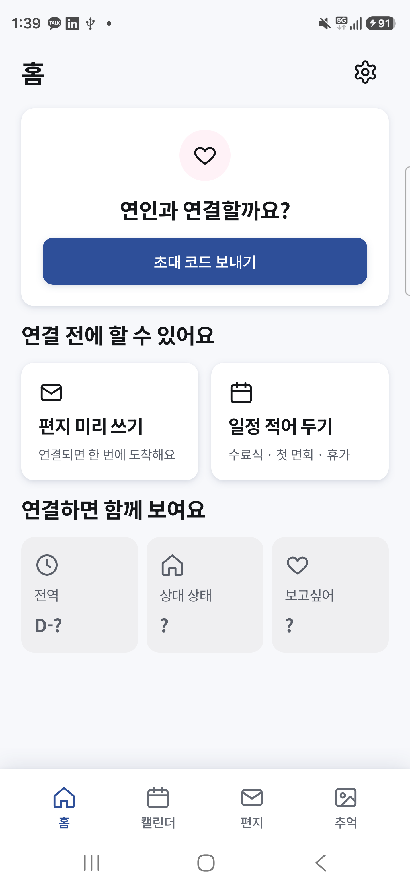
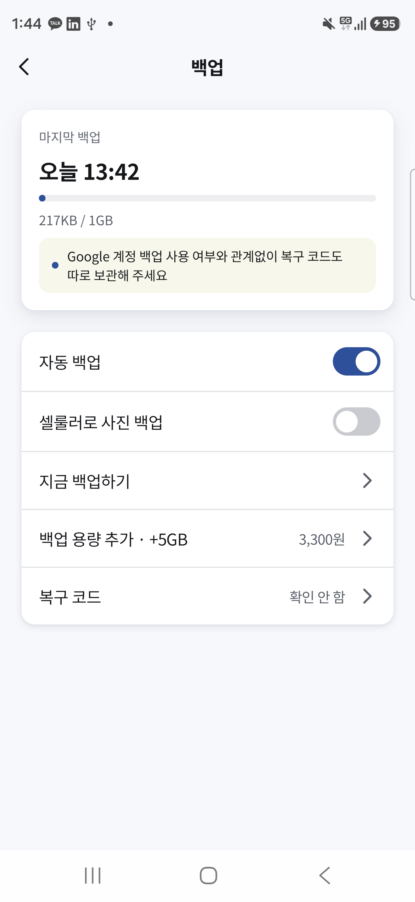
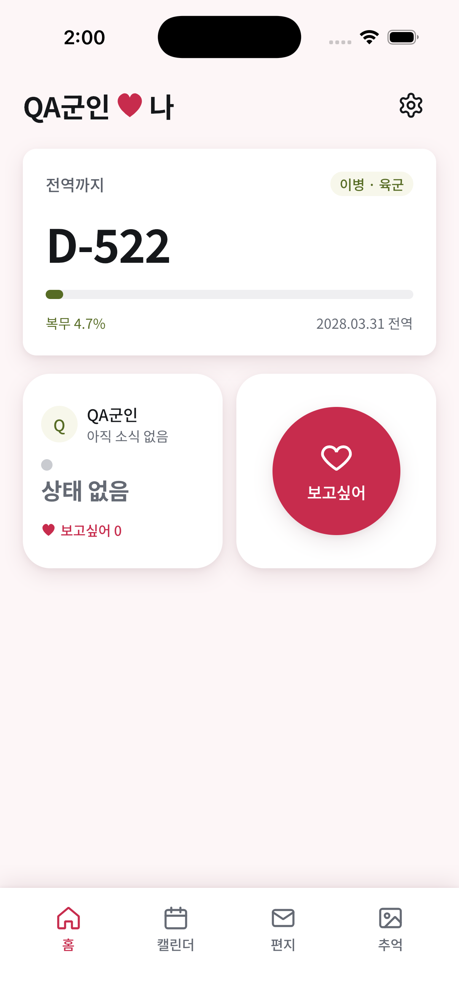

# 공통 코어 · Android 실기기 후속 QA (2026-10-26)

- Android16 실기기(4KB)와 Android17 에뮬레이터(16KB)에서 각각 통합2개 통과. 실제 Room/DataStore 암호화 백업→복원→새 기록→재백업과 demo Firebase Auth/Storage 왕복을 검증했다.
- 공통 JVM86개 통과(crypto10/sync13/backup16/data39/database8). 변경 없는 sync/database의 Gradle up-to-date 결과 포함.
- 사용자 승인으로 Android 최소8.0(API26), libsodium0.9.5를 사용한다. QA/Prod Release APK의 64비트 .so 각각12개 모두16KB LOAD 정렬, QA zipalign -P16 검사 통과.
- Android QA/Prod Release unsigned APK 및 iOS 프레임워크·앱/NSE/위젯 빌드 성공. iOS26.5에서 Xcode 원본 앱 실행 성공. 수동 재서명은 사용하지 않는다.
- 아래 Android 로그인은 로컬 demo-kkotsin의 가짜 계정이다. 실제 Google 로그인·Play 결제·Block Store는 미검증이다. 이 기기의 백업 UI에서217KB 성공을 확인했다.
- iOS 홈 화면은 최신 앱의 실행 증거다. 실제 APNs/NSE·App Store 구매·iCloud 두 기기 복원·기기 인증의 통과를 의미하지 않는다.

| Android 홈 | Android 백업 | 최신 iOS 실행 |
|---|---|---|
|  |  |  |
